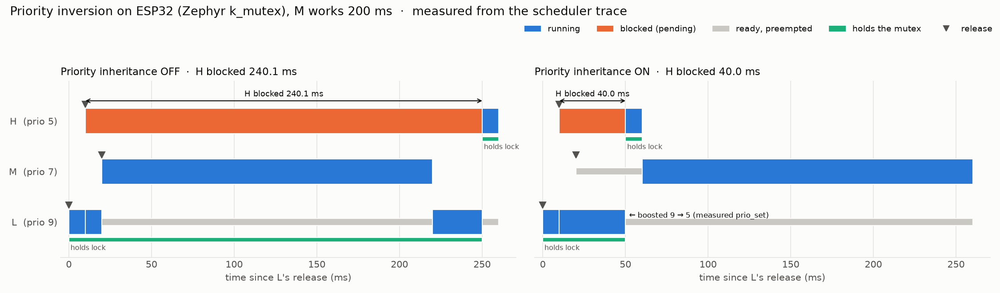
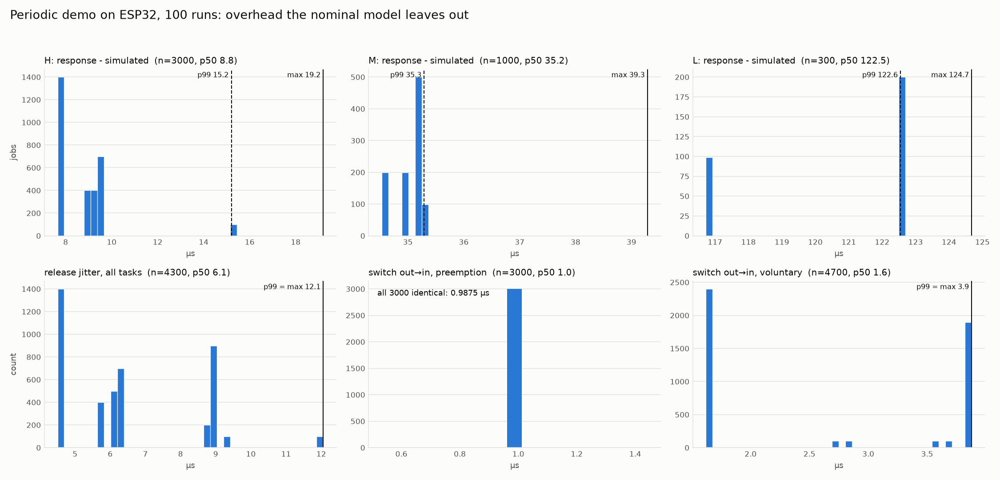
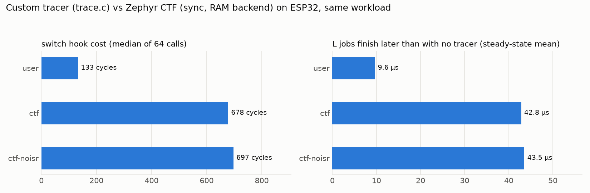
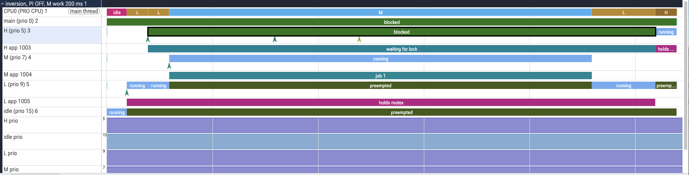
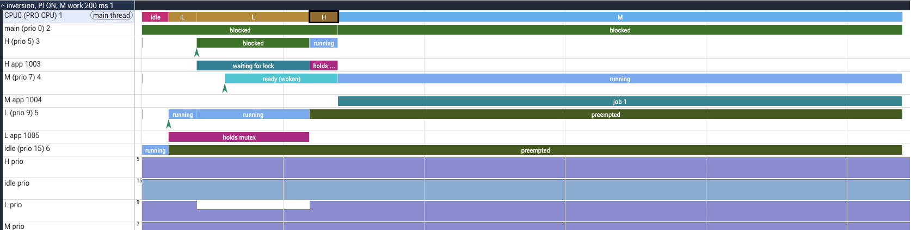

# rtoscope

[](https://github.com/2002-shashank/rtoscope/actions/workflows/ci.yml)

**Zephyr RTOS scheduling, instrumented and measured on a real ESP32.**

**Highlights**
- **Unbounded priority inversion, measured:** H blocked 240 ms without priority inheritance vs 40 ms with it.
- **Cycle-accurate tracer:** 0.55 µs per event, 5× cheaper than Zephyr's built-in CTF tracing, on the same workload.
- **Real-time analysis vs hardware:** response-time analysis with measured overheads bounds all 4300 jobs over
  100 runs, within 15 µs.
- **On-device safety:** deadline and inversion monitor (misses detected ≤ 8.1 µs after the deadline), plus a two-level watchdog proven
  with injected faults.
- **Tested end to end:** 89 pytest checks on real board logs, CI firmware builds, and Perfetto trace export.

rtoscope runs preemptive-priority workloads on a classic ESP32 (Xtensa LX6, 240 MHz) under Zephyr v4.4.2 and
measures what the scheduler actually does. A custom tracer hooks every context switch, wake-up and priority
change with CPU-cycle timestamps; the trace is dumped over UART with a CRC after each run and analyzed on the
host. On top of that it demonstrates unbounded priority inversion and its fix, compares textbook response-time
analysis with measured response times over 100 runs, detects deadline misses and inversion on the device, tests
a two-level watchdog with injected faults, benchmarks the tracer against Zephyr's built-in CTF tracing, and
exports everything to Perfetto.



*Measured on the board. Left: without priority inheritance, medium-priority M runs while H waits 240 ms for a
mutex held by low-priority L. Right: with inheritance, L is boosted to H's priority and H waits only 40 ms.*

---

## Headline results

All numbers come from captures in [`logs/`](logs/) and are reproduced by the tools and the test suite.

### 1. Priority inversion: inheritance off vs on

H (prio 5) requests a mutex held by L (prio 9) while M (prio 7) burns CPU without touching it.

| | H blocked | With M's work doubled (400 ms) |
|---|---|---|
| Priority inheritance **off** | **240.1 ms** | **440.1 ms** (grows with M: unbounded) |
| Priority inheritance **on** | **40.0 ms** | **40.0 ms** (L's remaining critical section: bounded) |

With inheritance on, the trace shows the kernel's own `prio_set` events boosting L from 9 to 5 and restoring it
on unlock. The same runs are viewable in Perfetto ([screenshots below](#view-traces-in-perfetto)). "Off" uses the same `k_mutex`, with `CONFIG_PRIORITY_CEILING` set at the idle priority, which compiles
inheritance out of the kernel.

### 2. Response-time analysis vs measurement

Three periodic tasks (C/T: 15/100, 40/300, 180/1000 ms; 46% utilization), two hyperperiods:

| Task | Textbook RTA | Measured worst | Overhead-aware RTA | Holds? |
|---|---|---|---|---|
| H | 15.000 ms | 15.019 ms | 15.027 ms | yes |
| M | 55.000 ms | 55.039 ms | 55.046 ms | yes |
| L | 265.000 ms | 265.125 ms | 265.140 ms | yes |

- **Textbook RTA is exceeded on every task, by 19–125 µs:** kernel overhead the model leaves out.
- **Adding measured overheads fixes it:** release jitter J (9–12 µs), switch cost S (≤ 3.9 µs), and worst
  measured CPU per job, via R = J + w, w = C′ + Σ⌈(w + Jⱼ)/Tⱼ⌉·C′ⱼ with C′ = C + 2S. Every job is then within the
  bound, with 7–15 µs to spare.
- **An exact simulation predicts every job to within those same microseconds.**

### 3. 100 repeated runs (4300 jobs)

| µs | n | p50 | p99 | max |
|---|---|---|---|---|
| H response − simulated | 3000 | 8.8 | 15.2 | 19.2 |
| M response − simulated | 1000 | 35.2 | 35.3 | 39.3 |
| L response − simulated | 300 | 122.5 | 122.6 | 124.7 |
| Release jitter (all tasks) | 4300 | 6.1 | 12.1 | 12.1 |
| Switch gap (out → in) at preemption | 3000 | 0.99 | 0.99 | 0.99 |

- **Every job is within the overhead-aware bound,** using worst-case inputs taken over all 100 runs.
- **Every maximum comes from run 1, which runs from a cold flash cache.** Runs 2–100 are identical to the cycle.
- **The distributions are discrete clusters, not noise.** Jitter depends on how many threads one timer tick
  wakes.
- **The out → in gap at a preemption is always 237 cycles.** That gap excludes the register save done at ISR
  entry; release-to-run latency is about 5 µs.



### 4. On-device monitor and watchdog

| Capture | Result |
|---|---|
| Inversion, PI off | Blocking alarm **60.0 ms** after H's request (its budget), with M running and owner L at prio 9: classified **unbounded inversion**. H's deadline miss was detected **0.1 µs** after the deadline, 140 ms before H got the lock. |
| Inversion, PI on | No alarms. |
| Periodic, healthy | No misses. The monitor costs about 7–9 µs per job. |
| Periodic, injected overrun | Exactly one miss (M, job 3), detected **8.1 µs** after its deadline. |
| Watchdog, no fault | Never tripped. |
| Watchdog, stuck preemptible thread | M's task-watchdog channel fired **300 ms** after the fault (last feed + 600 ms) and named M. The board rebooted and recovered. |
| Watchdog, stuck with IRQs locked | The task watchdog couldn't run; the **hardware** watchdog reset the chip (ROM: `TG0WDT_SYS_RESET`). The board recovered. |

Deadline timers are armed *before* each release, so a job starved past its deadline is still caught. The
watchdog gives each thread its own channel, backs it with TIMG0, and leaves "last words" in RTC memory that
survive the reset.

### 5. Custom tracer vs Zephyr CTF (same workload)

| | This tracer | Zephyr CTF (sync, RAM backend) |
|---|---|---|
| Switch hook cost | **133 cycles** (0.55 µs) | **678 cycles** (2.8 µs) |
| Bytes per event | 16 | 23.4 (switch events 30 B, including a 20 B name) |
| 32 KB buffer holds | 21 s of this workload (ring) | 12.6 s (linear: stops when full) |
| L job delay vs no tracer (steady state) | +9.6 µs | +42.8 µs |
| Schedule recorded (switches in/out, wake-ups, pends) | 77 / 77 / 47 / 1 | 77 / 77 / 47 / 1 (identical) |

Delays were measured with a tracer-independent probe (two CCOUNT reads per job), identical in every build.



---

## Hardware and software

- **Board:** Sunton ESP32-3248S035R ("CYD"): ESP32-WROOM-32, 4 MB flash, CH340 USB-serial. Built as
  `esp32_devkitc/esp32/procpu` (same module, console on UART0).
- **Zephyr v4.4.2**, Zephyr SDK 1.0.1 (`xtensa-espressif_esp32_zephyr-elf`), built natively on Apple Silicon macOS.
- **Timestamps:** Xtensa `CCOUNT` at 240 MHz (4.17 ns), read through `k_cycle_get_32()`, which on this board *is*
  CCOUNT. The kernel tick is 10 kHz.

## Build, flash, capture

The app is a freestanding Zephyr application; the west workspace lives elsewhere (here `~/zephyrproject`).

```sh
source ~/zephyrproject/.venv/bin/activate
export ZEPHYR_BASE=~/zephyrproject/zephyr
west blobs fetch hal_espressif            # once

west build -d build-pi.nosync -b esp32_devkitc/esp32/procpu app -p auto
west flash -d build-pi.nosync --esp-baud-rate 115200 --esp-device /dev/cu.usbserial-110
python3 tools/capture_serial.py /dev/cu.usbserial-110 logs/my_run.log 3     # resets the board, captures
```

`capture_serial.py` needs pyserial, which the Zephyr venv already provides.

**Flash at 115200 baud.** The default 921600 drops the connection on the CYD's CH340.

`west espressif monitor` has no `-d` option, so run it from inside the build directory:
`(cd build-pi.nosync && west espressif monitor -p /dev/cu.usbserial-110)`.

Variants are selected on the command line (append after `--`):

| Experiment | Options |
|---|---|
| Inversion, PI on (default) | *(none)* |
| Inversion, PI off | `-DCONFIG_RTOSCOPE_LOCK_MUTEX_NO_PI=y` (add `-DCONFIG_RTOSCOPE_M_WORK_MS=400` to double M) |
| Periodic tasks | `-DCONFIG_RTOSCOPE_DEMO_PERIODIC=y` |
| 100 runs | add `-DCONFIG_RTOSCOPE_PERIODIC_RUNS=100 -DCONFIG_RTOSCOPE_PERIODIC_HYPERPERIODS=1` |
| Deadline / blocking monitor | `-DCONFIG_RTOSCOPE_MONITOR=y` (+ `-DCONFIG_RTOSCOPE_INJECT_OVERRUN=y`) |
| Watchdog tests | `-DCONFIG_RTOSCOPE_WDT=y` with `-DCONFIG_RTOSCOPE_WDT_TEST_STARVE=y` or `_HANG=y` |
| Tracer comparison | `-DCONFIG_RTOSCOPE_PROBE=y` + `-DEXTRA_CONF_FILE=ctf.conf` or `notrace.conf` |

Multi-run and watchdog captures span resets. Use `--until "# rtoscope runs done"` with a generous time limit:

```sh
python3 tools/capture_serial.py /dev/cu.usbserial-110 logs/repeat.log 600 --until "# rtoscope runs done"
```

## Analyze, plot, test

```sh
python3.12 -m venv tools/.venv.nosync && tools/.venv.nosync/bin/pip install -r tools/requirements.txt
T=tools/.venv.nosync/bin/python

$T tools/plot_timeline.py        # inversion timelines        -> docs/step4_*.png, docs/step7_*.png
$T tools/response_times.py       # RTA vs simulation vs measured (exit 1 if a job beats the bound)
$T tools/repeat_stats.py         # 100-run statistics          -> docs/step6_histograms.png
$T tools/monitor_report.py       # monitor alarms, classification, detection latency
$T tools/tracer_compare.py       # tracer vs CTF               -> docs/step8_tracer_compare.png
$T tools/ctf_decode.py logs/step8_ctf.log --limit 20
tools/.venv.nosync/bin/pytest    # 89 tests
```

**What the tests cover:**
- **The parser:** synthetic captures, including replays of a real mid-line byte loss and a lost digit that only
  the CRC catches.
- **RTA and the simulator:** against hand-worked cases.
- **The committed logs as regression fixtures:** single-core trace invariants, the inversion and RTA results
  (including that the bound is *tight*), monitor/watchdog behaviour, and the tracer comparison.
- **The Perfetto export,** loaded with Perfetto's own trace processor.

The suite was mutation-tested: deliberately introduced bugs make it fail.

[`.github/workflows/ci.yml`](.github/workflows/ci.yml) runs the tests and builds every firmware variant with
warnings as errors, from [`west.yml`](west.yml) (Zephyr v4.4.2 + `hal_espressif`), on every push.

## View traces in Perfetto

```sh
$T tools/perfetto_export.py logs/step7_nopi_mon.log -o nopi.json     # or no args: rebuild docs/perfetto/
```

Open <https://ui.perfetto.dev> and drag the JSON in. Ready-made examples are in
[`docs/perfetto/`](docs/perfetto/).

Each trace is a process with these tracks:
- **CPU0:** which thread holds the CPU.
- **One track per thread** (running / preempted / blocked / ready), with release and monitor-alarm markers.
  Click an alarm to see who was running and who held the mutex.
- **An app track per thread:** jobs, waiting for lock, holds mutex.
- **A priority counter per thread:** inheritance shows as a step 9 → 5 → 9.



*Perfetto, priority inheritance **off** (`docs/perfetto/step7_nopi_mon.json`).*
- *H's `blocked` slice runs **~240 ms** while M holds CPU0 for 200 ms; L holds the mutex but is preempted.*
- *The two markers on H's track partway through the wait are the monitor's `blocked too long` and
  `deadline miss` alarms.*



*Perfetto, priority inheritance **on** (`docs/perfetto/step7_pi_mon.json`).*
- *H is blocked only **~40 ms**: L keeps the CPU (its `L prio` counter dips from 9 to 5 for exactly that span),
  releases the mutex, and H runs.*
- *M, ready since its release, runs only afterwards.*

## How it works

**Tracer** ([`app/src/trace.c`](app/src/trace.c)):
- Implements Zephyr's `CONFIG_TRACING_USER` hooks (switched in/out, ready, pend, priority set), plus app and
  monitor events.
- Each event is a 16-byte record in a 2048-entry RAM ring, timestamped from CCOUNT under `irq_lock`.
- The switch-out record stores the outgoing thread's state, so preempted / blocked / sleeping / exited is
  measured, not inferred.
- Nothing is printed during a run. The dump ends with a CRC-32 that the host verifies.

**Probe** ([`app/src/probe.c`](app/src/probe.c)): tracer-independent job timing for comparing builds.

**Monitor** ([`app/src/monitor.c`](app/src/monitor.c)): one-shot `k_timer`s at absolute deadlines and around
mutex waits. Each expiry snapshots the running thread and the mutex owner.

**Watchdog** ([`app/src/watchdog.c`](app/src/watchdog.c)): a `task_wdt` channel per thread, TIMG0 as hardware
fallback, last words in `.rtc_noinit`, and controlled fault injection that never reset-loops.

## Project structure

```
app/                    Zephyr application
  Kconfig, prj.conf     demo and feature options; ctf.conf / notrace.conf swap the tracer
  src/inversion.c       priority-inversion demo (H/M/L + k_mutex)
  src/periodic.c        periodic tasks, repeated runs, fault injection
  src/trace.c           custom tracer (Zephyr user tracing hooks -> RAM ring -> CSV + CRC)
  src/monitor.c         deadline + blocking-time monitors
  src/watchdog.c        task watchdog, hardware fallback, RTC last words
  src/tracer.c          tracer selection, CTF RAM dump, hook benchmark
  src/probe.c, dump.c, burn.c   job probe, CRC'd dump helper, CPU-time busy work
tools/                  host side (Python 3.12)
  tracelog.py           trace parser (CRC, truncation, per-thread states)
  response_times.py     RTA, overhead-aware RTA, exact simulation
  repeat_stats.py, monitor_report.py, tracer_compare.py, plot_timeline.py
  ctf_decode.py, ctf_layouts.py, gen_ctf_layouts.py    CTF decoding
  perfetto_export.py    Chrome / Perfetto JSON
  capture_serial.py     reset the board and capture its UART
tests/                  pytest suite (89 tests)
logs/                   board captures (the evidence for every number above)
docs/                   figures; docs/perfetto/ example traces
west.yml, .github/      manifest and CI
```

**Log names follow the build-up of the project:**

| Logs | Experiment |
|---|---|
| `step2_*` | first periodic printk demo |
| `step3_*` | inversion, before the tracer |
| `step4_*` | traced inversion |
| `step5_*` | RTA |
| `step6_*` | 100 runs |
| `step7_*` | monitor / watchdog |
| `step8_*` | tracer comparison |

## Limitations

- **Single core only.** Everything runs on the PRO CPU without SMP; CCOUNT is per-core, and the analysis assumes
  one CPU.
- **Hooks run from flash.** The tracer and monitor code executes through the flash cache, not IRAM. First
  executions pay cache misses: about 1000 cycles for a cold trace call vs 143 warm, and the run-1 outliers above.
- **No ISR tracing on Xtensa.** Zephyr v4.4.2's `arch/xtensa` never calls `sys_trace_isr_*`, so neither tracer sees
  interrupts (`CONFIG_TRACING_ISR` has no effect). Interrupt time is charged to whichever thread it interrupted.
- **The reset cause is ambiguous.** `hwinfo` reports `RESET_WATCHDOG` for both a software reboot and a hardware
  watchdog reset, because `sys_reboot()` goes through the RTC watchdog on this chip. RTC last words disambiguate.
- **Timings are specific to this setup:** one ESP32 (rev v3.1, 240 MHz, DIO flash at 40 MHz), this Zephyr version
  and configuration, and these workloads. Cross-build comparisons carry a few hundred ns of code-layout noise,
  and a cold first job must not be compared across binaries.
- **Small samples at the tail.** p99 over 300 L jobs rests on 3 samples; the bound checks use the max.
- **The serial path is lossy.** One capture lost 9 bytes. Every dump is CRC-checked, and corrupted runs are
  excluded and reported, not silently used.

## Future work

- **Dual-core (SMP):** check whether Zephyr v4.4.2 supports SMP on the classic ESP32, and if so, trace both cores
  (per-core CCOUNT alignment, cross-core wake-up latency, migration).
- Move the trace and monitor hooks to IRAM and re-measure the cold-cache outliers.
- Instrument ISRs on Xtensa with custom hooks, to separate interrupt time from thread time.
- Systrace (`sched_switch`) export, for Perfetto's native thread-state view.
- A binary-semaphore build of the inversion demo, to show that no `prio` events appear.
- Compare CTF in its default async mode, which adds a tracing thread.
- Hardware-in-the-loop CI: flash and capture on a self-hosted runner, so the log tests run on fresh data.
